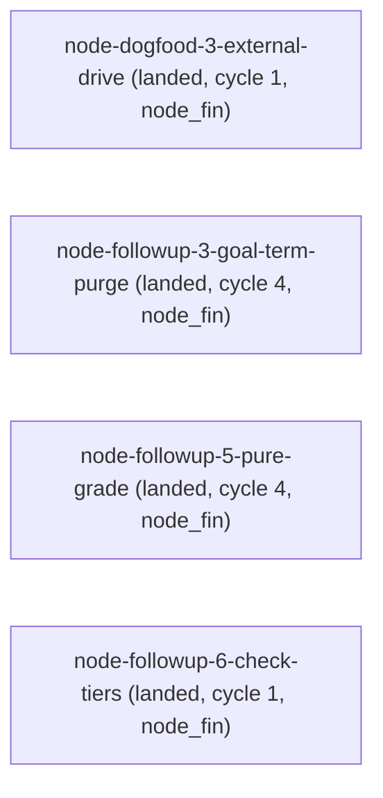

# landing.1 — walkthrough (executed in this Run)

Run: `20261118T144757Z-handoff-muse-code-muse-wonder-1.0-c1`.
Every output below was produced by the command shown, in this
Run, from the graph worktree; full JSON is in `tape.log`.
Label: `observed` throughout — no design traces.

## 1. Claim and context (observed)

```text
$ BP3_HARNESS=muse-code BP3_MODEL=muse-wonder-1.0 ./bin/bp3 harness link claim bp3link_5724…
{"ok":true,"run_id":"20261118T144757Z-handoff-muse-code-muse-wonder-1.0-c1","kind":"edge","node":"node-landing-1-landing-wrapup","edge":"handoff","state":"claimed",…}

$ ./bin/bp3 e
{"ok":true,"node":"node-landing-1-landing-wrapup","edge":"handoff","source_rung":"session","state":"todo","legal_edges":["handoff","block","delete"],…}
```

## 2. Rollup (observed, condensed)

```text
$ ./bin/bp3 g 2026-11-16-bp3-graph-engine-mvp-2-links-dags-pi-muse-engines r
landed: node-dogfood-3-external-drive (wall 1315 s),
  node-followup-3-goal-term-purge (wall 17466 s, cycle 4),
  node-followup-5-pure-grade (wall 16388 s, cycle 4),
  node-followup-6-check-tiers (wall 1950 s)
ready: 14 nodes (incl. this node); starved: []; inbox: []
warnings: ["W_SETUP_SLOW"]  (setup outliers in scorecard)
```

## 3. Diagrams from the live rollup (observed)

```text
$ ./bin/bp3 g <graph> diagram
graph 2026-11-16-bp3-graph-engine-mvp-2-links-dags-pi-muse-engines diagram (generated from live state at 2026-11-18T14:48:37Z)
rollup: active
nodes:
  node-dogfood-3-external-drive (landed, cycle 1, node_fin)
  node-followup-3-goal-term-purge (landed, cycle 4, node_fin)
  node-followup-5-pure-grade (landed, cycle 4, node_fin)
  node-followup-6-check-tiers (landed, cycle 1, node_fin)
  … 14 nodes (todo, cycle 1), incl. node-landing-1-landing-wrapup …
deps:
  (none)
waves:
  wave 1: (the 14 todo nodes)
starved:
  (none)
```



(Full 18-node mermaid in `tape.log`; the four landed nodes are
quoted verbatim above.)

## 4. Landed node read (observed, condensed)

```text
$ ./bin/bp3 g <graph> n node-dogfood-3-external-drive r
{"ok":true,"state":"landed","fin":"node_fin","cycle":1,"commit":"ac43954bd4e746115fc8761b3ce8f2fe95063c68","timing":{"wall_s":1315,"wait_s":null,"dwell_s":{"approved":76,"handed_off":1239}},"legal_edges":[]}
```

## 5. A/B and ready-set results

Presented from the dogfood nodes' own numbers in
`scorecard.md` § Dogfood numbers (dogfood.1: 425 → 70/68 brief
chars, three claim refusals, zero setup cycles; dogfood.2:
3955 ms ready wall vs 6890 ms serial). Those drives are the
tests (`test/dogfood-link.sh`, `test/dogfood-parallel.sh`);
they were not re-driven in this Run.

## Checkpoint

This record is the owner's promotion input. Promotion,
graph-status change, and desk release are the owner's word at
goal_fin — none is taken here.
